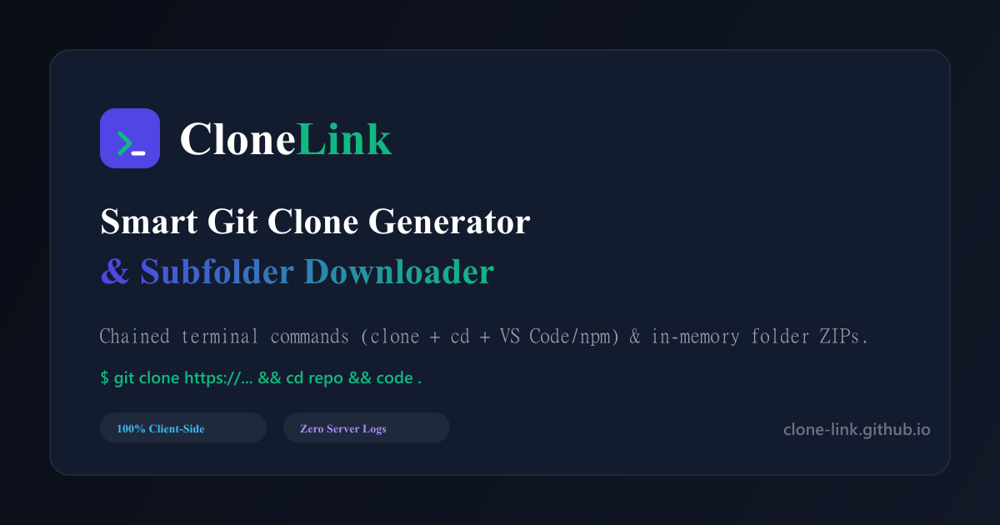
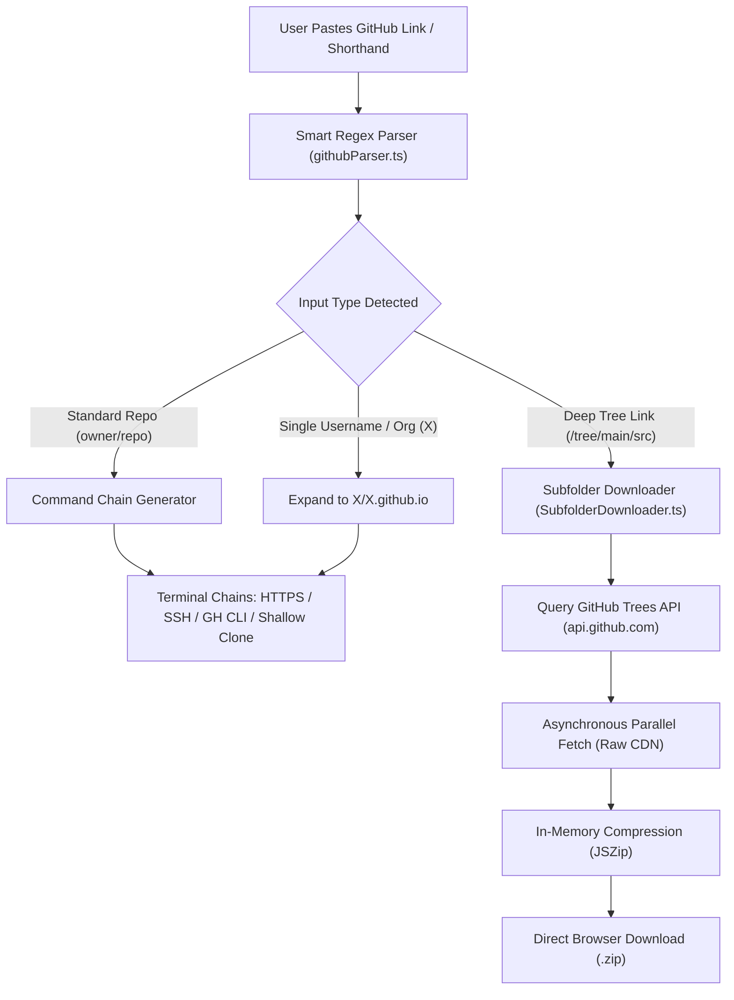

<div align="center">

  

  # CloneLink

  ### Smart Git Clone Command Generator & In-Browser Subfolder Downloader

  An ultra-minimalist, 100% client-side developer utility built with **Astro 5** and **React 19**.<br />
  Instantly turn any GitHub URL or shorthand into chained terminal commands, or download isolated repo subfolders as a ZIP directly in your browser with zero server dependencies.

  <p align="center">
    <a href="https://clone-link.github.io"><strong>🌐 Live Web App</strong></a> •
    <a href="#-key-features"><strong>✨ Features</strong></a> •
    <a href="#-architecture"><strong>🏗️ Architecture</strong></a> •
    <a href="#-url-syntax-support"><strong>🔗 URL Patterns</strong></a> •
    <a href="#-local-development"><strong>💻 Getting Started</strong></a>
  </p>

  <p align="center">
    <a href="https://clone-link.github.io"></a>
    <a href="https://github.com/clone-link/clone-link.github.io/actions/workflows/deploy.yml"></a>
    <a href="LICENSE"></a>
    <a href="https://ko-fi.com/kishara"></a>
  </p>

  <p align="center">
    
    
    
    
    
    
  </p>

  <br />

  

</div>

---

## ⚡ The Problem & The Solution

Cloning giant repositories to inspect a single component, example, or subfolder is a tedious, bandwidth-wasting process. Developers also routinely type repetitive terminal chains (`git clone ...`, `cd ...`, `code .`, `npm i && npm run dev`).

**CloneLink solves both friction points in milliseconds:**
1. **Instant Command Chains**: Paste any repository URL or shorthand to generate one-click copyable terminal chains with protocol toggles (HTTPS, SSH, GitHub CLI) and package manager switches (`npm`, `pnpm`, `yarn`, `bun`).
2. **In-Browser Subfolder Downloader**: When a URL points to a subfolder (e.g. `/tree/main/packages/core`), CloneLink scans the tree via GitHub's public API, fetches files in parallel, and compresses them into a `.zip` file right in browser memory using `JSZip`. No Git CLI, no server proxies, and no wasted bandwidth.

---

## ✨ Key Features

- 🧠 **Smart Deep URL Parsing**: Accepts full HTTPS URLs, SSH URIs, `owner/repo` shorthands, and deep directory trees (`repo/tree/branch/subfolder`).
- 🏢 **Single-Organization Auto-Expansion**: Typing a single username or organization name (e.g. `torvalds` or `tailwindlabs`) automatically expands to its personal GitHub Pages root repository (`user/user.github.io`).
- ⚡ **Multi-Chain Terminal Commands**:
  - **Clone & Enter**: `git clone <url> && cd <repo>`
  - **Clone & Open in VS Code**: `git clone <url> && cd <repo> && code .`
  - **Clone, Install & Dev**: `git clone <url> && cd <repo> && npm i && npm run dev`
  - **GitHub Pages Quick-Clone**: Dedicated shortcut for personal GitHub Pages repositories.
  - **Native Git Sparse-Checkout**: Native Git command to sparse-clone only the specified subfolder.
- 📦 **Browser-Side In-Memory ZIP**: Fetches remote directories via GitHub REST API and raw CDN endpoints, assembling `.zip` archives directly in memory.
- 🔑 **Optional GitHub Token**: Built-in support for personal access tokens stored strictly in browser `localStorage` to expand API limits from 60 to 5,000 requests/hour.
- 🌐 **7-Language Subpath i18n**: Full localized routing with language switcher:
  - English (`/`)
  - Español (`/es`)
  - Português (`/pt`)
  - Deutsch (`/de`)
  - Français (`/fr`)
  - 日本語 (`/ja`)
  - 简体中文 (`/zh`)
- 🎨 **Developer-Centric UI/UX**:
  - Clean Light (`#FAFAFA`) & Deep Slate Dark (`#090D16`) themes with zero Flash of Unstyled Theme (FOUT).
  - Sticky navbar collapsing strictly to **ICONS ONLY** on tablet & mobile breakpoints.
  - JetBrains Mono monospace code boxes with one-tap full-width copy buttons on mobile.
- 🏆 **100% Technical SEO**:
  - Valid `WebApplication`, `WebSite`, `BreadcrumbList`, and `FAQPage` JSON-LD schemas.
  - Bidirectional `hreflang` alternate links, Open Graph cards, sitemap index, and robots.txt.
  - WCAG AA accessibility compliance with screen-reader skip links and `aria-live` announcements.

---

## 🏗️ Architecture



---

## 🔗 URL Patterns & Syntax Support

CloneLink automatically recognizes and parses all of the following formats:

| Format Description | Input Example | Generated Output Target |
| :--- | :--- | :--- |
| **Shorthand** | `facebook/react` | `facebook/react` (HTTPS / SSH / CLI) |
| **Full HTTPS URL** | `https://github.com/facebook/react` | `facebook/react` (Branch: default) |
| **Git Clone URL** | `https://github.com/facebook/react.git` | `facebook/react` (Stripped `.git`) |
| **SSH Endpoint** | `git@github.com:facebook/react.git` | `facebook/react` (Cleaned repo) |
| **Deep Tree / Folder** | `vercel/next.js/tree/canary/examples` | Subfolder: `examples` • Branch: `canary` |
| **Nested Subfolder** | `shadcn-ui/ui/tree/main/apps/www/src/components` | Subfolder: `apps/www/src/components` |
| **Single Organization** | `kisharadilz` | Auto-expands to `kisharadilz/kisharadilz.github.io` |

---

## 🛠️ Tech Stack & Dependencies

| Category | Technology | Purpose |
| :--- | :--- | :--- |
| **Framework** | [Astro 5.x](https://astro.build/) | Static Site Generation (SSG), subpath i18n routing, zero-JS baseline |
| **UI Island** | [React 19](https://react.dev/) | Real-time input parsing, clipboard states, subfolder progress UI |
| **Styling** | [Tailwind CSS 3.4](https://tailwindcss.com/) | Developer-grade light/dark themes, JetBrains Mono font tokens |
| **In-Memory ZIP** | [JSZip 3.10](https://stuk.github.io/jszip/) | Client-side folder archive creation without a backend server |
| **Micro-Interactions**| [Canvas Confetti](https://www.npmjs.com/package/canvas-confetti) | Celebratory animation on successful ZIP packaging |
| **Deployment** | [GitHub Pages](https://pages.github.com/) | Static root hosting via GitHub Actions (`actions/deploy-pages`) |

---

## 💻 Local Development

### Prerequisites
- **Node.js**: v20+ (v22 or v24 recommended)
- **Package Manager**: npm, pnpm, yarn, or bun

### Setup Steps

```bash
# 1. Clone repository
git clone https://github.com/clone-link/clone-link.github.io.git
cd clone-link.github.io

# 2. Install dependencies
npm install

# 3. Launch local development server
npm run dev
```

Visit `http://localhost:4321` in your browser.

### Available Scripts

| Script | Command | Description |
| :--- | :--- | :--- |
| `dev` | `npm run dev` | Boots local Astro development server with HMR |
| `build` | `npm run build` | Compiles static production bundle to `dist/` |
| `preview` | `npm run preview` | Serves the production build locally for verification |

---

## 📂 Project Structure

```text
clone-link.github.io/
├── .github/
│   └── workflows/
│       └── deploy.yml          # GitHub Actions deployment to GitHub Pages
├── public/
│   ├── favicon.svg             # Scalable vector favicon
│   ├── og-image.png            # 1200x630 pre-rendered social card
│   ├── robots.txt              # Search engine crawling rules
│   ├── sitemap.xml             # Complete XML sitemap with 7-language hreflangs
│   ├── sitemap-index.xml       # Sitemap index entry
│   └── site.webmanifest        # Progressive Web App manifest
├── src/
│   ├── components/
│   │   ├── CloneGenerator.tsx  # React Island: URL parser, command cards, ZIP engine
│   │   ├── Faq.astro           # Accessible FAQ accordion section
│   │   ├── Features.astro      # Architecture benefit highlight cards
│   │   ├── Footer.astro        # Accessible footer with developer support links
│   │   └── Navbar.astro        # Sticky navbar with responsive icon-only collapse
│   ├── i18n/
│   │   ├── locales/            # 7 language JSON translation dictionaries
│   │   │   ├── en.json         # English (Default)
│   │   │   ├── es.json         # Español
│   │   │   ├── pt.json         # Português
│   │   │   ├── de.json         # Deutsch
│   │   │   ├── fr.json         # Français
│   │   │   ├── ja.json         # 日本語
│   │   │   └── zh.json         # 简体中文
│   │   ├── languages.ts        # Language metadata and badges (US, ES, BR, DE, etc.)
│   │   └── utils.ts            # Translation hooks & localized path helpers
│   ├── layouts/
│   │   └── Layout.astro        # Master HTML layout, 100% SEO schemas, FOUT script
│   ├── pages/
│   │   ├── index.astro         # English root landing page (/)
│   │   └── [lang]/
│   │       └── index.astro     # SSG dynamic localized pages (/es, /pt, /de, etc.)
│   └── utils/
│       ├── githubParser.ts     # Regex engine & command string builder
│       └── SubfolderDownloader.ts # In-memory recursive GitHub folder ZIP downloader
├── astro.config.mjs            # Astro configuration with React, Tailwind, and i18n
├── tailwind.config.mjs         # Design tokens, dark mode class, font families
├── tsconfig.json               # TypeScript configuration with path aliases
└── package.json
```

---

## 🔒 Privacy & Security

- **0% Server Tracking**: CloneLink does not utilize an intermediate backend, proxy, or server-side database.
- **Direct GitHub Requests**: File fetch requests and API queries travel directly from your browser to `api.github.com` and `raw.githubusercontent.com`.
- **LocalStorage Security**: Optional GitHub Personal Access Tokens and recent repository histories are stored solely in your local browser `localStorage` and never transmitted to external third parties.

---

## ☕ Support the Developer

If CloneLink saves you time in your daily development workflow, consider supporting its maintenance and development:

<p align="left">
  <a href="https://ko-fi.com/kishara" target="_blank">
    
  </a>
</p>

Created with passion by **[Kishara Dilshan](https://ko-fi.com/kishara)**.

---

## 📄 License

This project is open-source and distributed under the **[MIT License](LICENSE)**.
